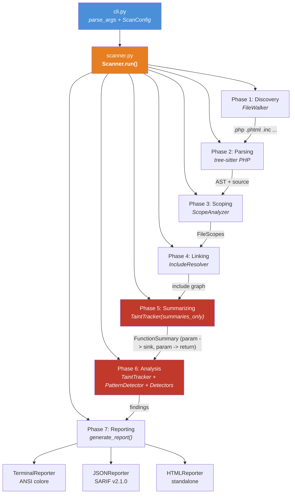
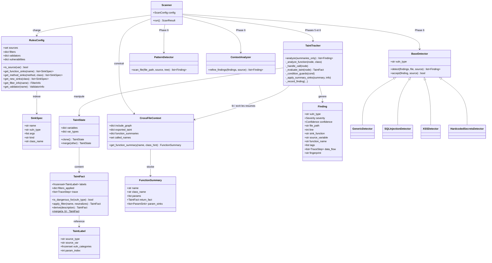
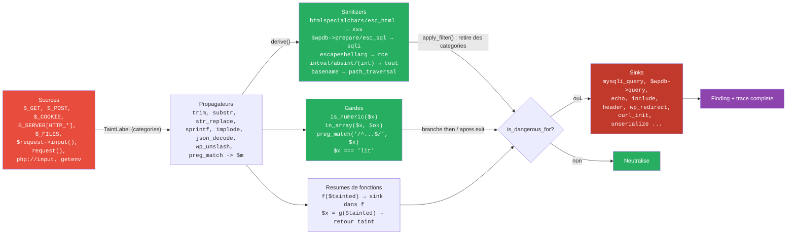

# Python.PHP.Whitebox - Analyseur Statique de Securite PHP (White-Box)

Outil Python d'analyse statique pour projets PHP : taint tracking inter-procedural sur AST tree-sitter,
19 types de vulnerabilites, regles **PHP generique + WordPress + frameworks** (Laravel, Symfony,
CodeIgniter, PSR-7), reporting terminal / JSON-SARIF / HTML.

## Quick Start

```bash
# Installation
pip install -r requirements.txt

# Scan basique (output terminal)
python3 -m cli /var/www/monprojet/

# Plugin ou theme WordPress
python3 -m cli wp-content/plugins/mon-plugin --format html -o report.html

# Site WordPress complet, sans le core
python3 -m cli /var/www/wordpress --exclude "wp-admin/*" "wp-includes/*"

# Scan cible avec filtre
python3 -m cli /var/www/monprojet/ --vuln-types sql_injection xss rce

# Rapport SARIF (GitHub code scanning, IDE) / JSON
python3 -m cli /var/www/monprojet/ --format sarif -o results.sarif

# CI : ne retourner 1 que pour high/critical, ignorer les flux peu surs
python3 -m cli . --severity-min high --confidence-min medium --fail-on high
```

## Fonctionnalites

- **Parsing AST** avec la grammaire tree-sitter PHP (PHP 5.x a 8.x : match, fn, enum, nullsafe,
  attributs, heredoc, syntaxe alternative `if (...) : endif`, `<?= ?>`, HTML mele)
- **Taint tracking par label** : chaque source garde ses propres categories restantes, donc
  `htmlspecialchars($a) . $b` reste dangereux via `$b`
- **Analyse inter-procedurale** : resumes de fonctions/methodes (parametre -> sink, parametre -> retour)
  calcules pour tout le projet avant l'analyse, y compris entre fichiers non relies par `include`
  (autoload, hooks). Le finding est rapporte sur la ligne du sink avec la trace complete appel -> sink
- **Methodes et classes** : `$this->prop` partage entre methodes, `$x = new Foo` pour resoudre
  `$x->method()`, appels statiques `Foo::bar()`, constructeurs `new SimpleXMLElement($x)`
- **Closures** analysees en ligne (`add_action('init', function () { ... })`, `use ($x)`, `fn() =>`)
- **Gardes de validation** dans les conditions, sensibles au chemin :
  `if (!is_numeric($id)) exit;`, `in_array($x, $allowed)`, `preg_match('/^[a-z0-9_-]+$/', $x)`,
  `$x === 'literal'`, `isset($whitelist[$x])`, `filter_var($x, FILTER_VALIDATE_INT)`
- **Sanitizers contextuels** : `htmlspecialchars` neutralise XSS mais pas SQLi ; `intval`/`(int)`/
  `absint` neutralisent tout ; `filter_var` selon le flag ; `preg_replace('/[^a-z0-9]/', '', $x)`
  reconnu comme whitelist ; `array_map('intval', $ids)` ; sanitizers faibles (`addslashes`) gardent
  le finding en confiance basse
- **WordPress** : `$wpdb->query/get_results/get_var/get_row/get_col/prepare`, `esc_html/esc_attr/esc_url/
  esc_js/wp_kses*`, `sanitize_text_field/sanitize_key/absint/...`, `wp_redirect` vs `wp_safe_redirect`,
  `wp_remote_*` vs `wp_safe_remote_get`, `maybe_unserialize`, `get_template_part`, `wp_mail`, hooks et
  callbacks dynamiques, contexte `current_user_can()` (findings tagges `privileged-context`,
  severite reduite d'un cran)
- **Frameworks** : `$request->input()/query()/get()/...`, proprietes magiques `$request->name`,
  `request()`, `Request::input()`, parametres types `Request $request`, `DB::select/whereRaw/...`,
  `redirect()`, `Storage::get`, `Response`, PSR-7 `getParsedBody()`...
- **`--taint-params`** : traite les parametres des fonctions jamais appelees (hooks, controleurs,
  endpoints REST) comme controles par l'utilisateur (findings a confiance basse)
- **Reporting multi-format** : terminal colore, JSON SARIF 2.1.0 (codeFlows), HTML autonome ;
  baseline pour ne voir que les nouveaux findings ; `--fail-on` pour la CI
- **Robuste** : encodage tolerant, recuperation d'erreurs de syntaxe, concatenations de milliers de
  termes, dedoublonnage, extensions `.php .phtml .inc .module .theme ...`

## Vulnerabilites Detectees

| Type | CWE | Severite | Description |
|------|-----|----------|-------------|
| SQL Injection | CWE-89 | Critical | Donnees utilisateur dans les requetes SQL (mysqli, PDO, `$wpdb`, `DB::`, Doctrine, CodeIgniter...) |
| XSS | CWE-79 | High | Sortie HTML non encodee (`echo`, `print`, `<?=`, `printf`, `_e`, `wp_die`, `Response`...) |
| RCE / Command Injection | CWE-78 | Critical | Commandes systeme (`system`, `exec`, backticks, `proc_open`, `mail` 5e arg...) |
| Code Injection | CWE-94 | Critical | `eval`, `assert`, callbacks dynamiques (`call_user_func`, `array_map`, `add_action`), `$fn()`, `new $cls` |
| File Inclusion (LFI/RFI) | CWE-98 | Critical | `include/require`, `get_template_part`, `load_template` |
| Path Traversal | CWE-22 | High | Acces fichiers (`file_get_contents`, `unlink`, `glob`, `SplFileObject`, `WP_Filesystem`, `Storage::`...) |
| Insecure Upload | CWE-434 | High | Destination d'upload derivee du nom de fichier utilisateur |
| Insecure Deserialization | CWE-502 | Critical | `unserialize` (sauf `allowed_classes => false`), `maybe_unserialize`, `yaml_parse` |
| SSRF | CWE-918 | High | `curl_init/curl_setopt(CURLOPT_URL)`, `file_get_contents(url)`, `wp_remote_*`, `Http::`, `SoapClient` |
| XXE | CWE-611 | High | Parsing XML de donnees utilisateur (confiance haute seulement si `LIBXML_NOENT` present) |
| XPath Injection | CWE-643 | High | `DOMXPath::query/evaluate`, `SimpleXMLElement::xpath` |
| Open Redirect | CWE-601 | Medium | `header('Location: ...')`, `wp_redirect`, `redirect()`, `RedirectResponse` |
| LDAP Injection | CWE-90 | High | `ldap_search`, `ldap_bind`, `ldap_add`... |
| Session Fixation | CWE-384 | Medium | `session_id($input)` |
| Variable Overwrite | CWE-621 | Medium | `extract($_POST)`, `parse_str($q)` sans 2e argument |
| E-mail Injection | CWE-93 | Medium | En-tetes `mail()` / `wp_mail()` construits avec des donnees utilisateur |
| Crypto Weakness | CWE-327 | Medium | md5/sha1 sur des credentials, `rand()` pour des tokens, mcrypt, ECB, TLS verify desactive |
| Hardcoded Secrets | CWE-798 | High | Mots de passe, cles API, tokens (AWS, GitHub, Slack, Stripe, JWT), `define('DB_PASSWORD', ...)` ; placeholders ignores |
| Type Juggling | CWE-697 | Medium | `==` sur des hashes, `strcmp() == 0`, `in_array` non strict sur l'input |
| Dangerous Config | CWE-209/98/200... | variable | `display_errors`, `allow_url_include`, `phpinfo()`, `WP_DEBUG_DISPLAY`, `DISALLOW_FILE_EDIT`... |

Les types, sinks, sanitizers et validateurs sont declares dans `config/rules.yaml` : ajouter un type
de vulnerabilite ne demande aucun code (un `GenericDetector` est cree automatiquement).

## Architecture

### Pipeline de scan



### Diagramme des classes



### Flux du taint tracking



## Structure du Projet

```
Python.PHP.Whitebox/
  cli.py                            # Point d'entree CLI
  scanner.py                        # Orchestrateur du pipeline (7 phases)

  parser/
    php_parser.py                   # Parser tree-sitter PHP (encodage resilient)
    scope_analyzer.py               # Extraction fonctions/classes/methodes
    include_resolver.py             # Resolution des include/require statiques

  analysis/
    taint_state.py                  # TaintLabel (categories par label), TaintFact, TaintState
    taint_tracker.py                # Moteur de taint : hoisting, resumes, gardes, closures, sinks
    cross_file_context.py           # Resumes de fonctions, graphe d'includes, taint exporte
    pattern_detector.py             # Detection par regex (secrets, crypto, configs), commentaires ignores
    context_analyzer.py             # Ajustements contextuels (XXE/LIBXML_NOENT, prepared statements)

  detectors/
    __init__.py                     # Registre : classes dediees + GenericDetector pour le reste
    base.py                         # BaseDetector / GenericDetector
    *.py                            # Detecteurs specialises (sql_injection, xss, xxe, hardcoded_secrets...)

  config/
    schema.py                       # Enums + dataclasses (SinkSpec, FilterInfo, ValidatorInfo, ScanConfig)
    loader.py                       # Chargement + indexation rules.yaml
    rules.yaml                      # Sources, sinks, sanitizers, validateurs, patterns (PHP + WP + frameworks)

  report/
    finding.py                      # Finding, ScanResult, ScanSummary
    baseline.py                     # Comparaison avec scan precedent
    json_reporter.py                # JSON / SARIF v2.1.0
    html_reporter.py                # HTML standalone
    terminal_reporter.py            # Terminal ANSI

  utils/
    filewalker.py                   # Recherche de fichiers PHP (extensions, exclusions)
    ast_helpers.py, text.py         # Helpers AST
    progress.py                     # Barre de progression

  tests/
    php_samples/scripts/            # Cas unitaires (sqli, xss, guards, interprocedural...)
    php_samples/app/                # Mini-application PHP orientee objet
    php_samples/wordpress/          # Plugin + template WordPress
    php_samples/frameworks/         # Controleur Laravel
    unit/, integration/             # 144 tests pytest
```

## Options CLI

```
usage: Python.PHP.Whitebox [-h] [--vuln-types TYPE [TYPE ...]] [--format {terminal,json,sarif,html}]
                  [-o OUTPUT] [--severity-min {info,low,medium,high,critical}]
                  [--confidence-min {low,medium,high}] [--exclude PATTERN [PATTERN ...]]
                  [--extensions EXT [EXT ...]] [--config PATH] [--baseline PATH]
                  [--taint-params] [--fail-on {none,info,low,medium,high,critical}]
                  [--no-color] [-v | -q]
                  path

Arguments:
  path                          Repertoire (ou fichier) PHP a analyser

Options:
  --vuln-types TYPE [TYPE ...]  Types de vulnerabilites a scanner (defaut: tous ceux de rules.yaml)
  --format {terminal,json,sarif,html}  Format de sortie (defaut: terminal ; sarif = JSON SARIF 2.1.0)
  -o, --output OUTPUT           Fichier de sortie
  --severity-min LEVEL          Severite minimale a reporter (defaut: info)
  --confidence-min LEVEL        Confiance minimale (defaut: low). medium elimine les flux via methodes inconnues
  --exclude PATTERN ...         Patterns d'exclusion (ex: vendor/* tests/* wp-includes/*)
  --extensions EXT ...          Extensions a analyser (defaut: .php .phtml .inc .module .theme .install ...)
  --config PATH                 Fichier de regles YAML custom
  --baseline PATH               Scan precedent (JSON) : nouveaux findings uniquement
  --taint-params                Parametres des fonctions jamais appelees consideres comme input utilisateur
  --fail-on LEVEL               Code de sortie 1 si un finding atteint cette severite (defaut: info ; none = 0)
  --no-color                    Desactiver les couleurs
  -v, --verbose / -q, --quiet   Verbosite
```

## Moteur de Taint Analysis

### Sources
`$_GET`, `$_POST`, `$_COOKIE`, `$_REQUEST`, `$_FILES` (`name`, `type` ; pas `tmp_name`/`size`),
`$_SERVER` (uniquement `HTTP_*`, `REQUEST_URI`, `QUERY_STRING`, `PATH_INFO`, `PHP_SELF`, ...),
`$_ENV`/`getenv`/`$argv` (confiance basse), `php://input`, `getallheaders()`, `get_query_var()`,
objets requete des frameworks (`$request->...`, `request()`, `Request::`, parametres types `Request`),
PSR-7 (`getParsedBody()`, `getQueryParams()`...), `WP_REST_Request::get_param()`.

### Propagation
- Assignations, concatenation, interpolation (`"$x"`, heredoc, backticks), `??`, ternaire, `match`
- Tableaux : `$_GET['k']`, `$data['id']`, `list()`/`[$a, $b] =`, `foreach` (cle et valeur), `compact`
- Proprietes : `$this->prop` (flow-insensitive entre methodes), `$obj->prop` sur objet tainted
- Appels : propagateurs (`trim`, `str_replace`, `json_decode`...), fonctions user-defined via resume,
  sorties par reference (`preg_match(..., $m)`, `parse_str($q, $out)`), fonctions inconnues
  (conservatif : confiance reduite), methodes inconnues (confiance basse)
- Casts : `(int)`/`(float)`/`(bool)` neutralisent tout, `(string)` propage ; arithmetique et
  comparaisons produisent des valeurs sures

### Sanitizers contextuels
Declares dans `rules.yaml` avec les categories neutralisees, l'index de l'argument filtre
(`mysqli_real_escape_string($conn, $s)` -> arg 1), un mode variadique (`$wpdb->prepare`) ou un
argument de flags (`filter_var`). `neutralizes: all` pour les conversions numeriques.
Les sanitizers a confiance `low` (`addslashes`, `mysql_escape_string`) ne neutralisent pas : le
finding est conserve en confiance basse.

### Flux de controle
- **if/elseif/else** (accolades, statement unique ou syntaxe `:`) : clone, gardes appliquees a la
  branche then (forme negative a la branche else), merge conservatif. Si une branche se termine
  (`exit`, `return`, `throw`, `wp_die`, `break`...), l'etat de l'autre branche est conserve seul :
  `if (!is_numeric($id)) die(); query($id)` est sur.
- **boucles** (`while`, `do`, `for`, `foreach`) : 2 iterations pour le taint loop-carried, findings
  dedoublonnes
- **switch** : chaque `case` litteral neutralise la variable testee dans son bloc
- **try/catch/finally**, `global`, `$GLOBALS`, `unset`
- **Contexte privilegie** : sinks sous `current_user_can()` / `is_admin()` -> tag `privileged-context`

### Limites connues
- Flux de second ordre (donnees relues en base, options WordPress) non suivis : le resultat d'un sink
  (`mysqli_query`, `file_get_contents`) est considere opaque.
- Proprietes initialisees depuis un parametre de constructeur (`$this->x = $x` puis sink dans une autre
  methode) ne sont suivies que si la valeur est une source directe.
- Closures stockees dans une variable puis appelees (`$f = fn() => ...; $f()`) ne propagent pas leur retour.
- Templates Blade/Twig non analyses (fichiers `.blade.php` parses comme du PHP).
- Les fonctions inconnues dont le nom evoque un nettoyage (`sanitize*`, `escape*`, `clean*`, `validate*`)
  sont supposees sures (`heuristics.assume_sanitizer_pattern`, desactivable dans `rules.yaml`).

## Personnaliser les regles

`config/rules.yaml` est le seul fichier a modifier pour ajouter un sink, un sanitizer ou un type :

```yaml
vulnerabilities:
  my_sink_type:
    cwe: "CWE-xxx"
    severity: "high"
    sinks:
      - "my_dangerous_function"               # fonction globale, tous les arguments
      - {name: "my_lib_call", args: [1]}      # seulement le 2e argument
      - "->dangerousMethod"                   # methode sur n'importe quel objet
      - "MyClass::run"                        # methode si la classe est connue ($x = new MyClass / $myclass)
      - "new MyParser"                        # constructeur
filters:
  my_escape: {neutralizes: ["my_sink_type", "xss"]}
validators:
  my_is_valid: {neutralizes: all, arg: 0}
```

Un fichier custom se passe avec `--config mes_regles.yaml`.

## Dependances

```
tree-sitter~=0.24.0
tree-sitter-php~=0.23.11
PyYAML~=6.0.2
```

---

## Tests

```bash
pip install pytest
python3 -m pytest -q            # 144 tests
```

- `tests/unit/test_taint_tracker.py` : sources -> sinks de base, sanitizers, branches
- `tests/unit/test_advanced.py` : gardes, inter-procedural, proprietes, closures, WordPress, Laravel,
  templates, `--taint-params`, absence de faux positifs
- `tests/unit/test_rules.py`, `test_pattern_detector.py`, `test_finding.py`, `test_filewalker.py`
- `tests/integration/` : pipeline complet, rapports JSON/HTML, mini-application

## Stack

[](https://skillicons.dev)
